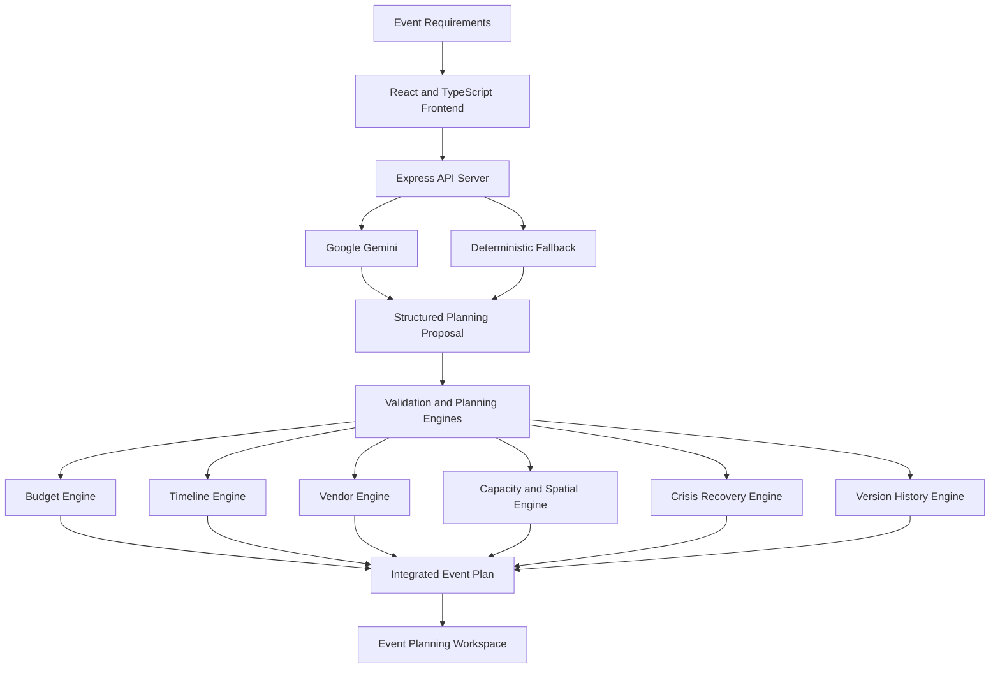

# CelebraAI — GenAI-Powered Celebration & Event Planner

**Plan beautifully. Prepare for anything.**

CelebraAI is an AI-powered event planning solution that helps organizers plan weddings, birthdays, cultural festivals, and community celebrations through a unified, intelligent workspace.

The system transforms event requirements into personalized planning proposals containing creative ideas, itemized budgets, task timelines, vendor checklists, and interactive 3D venue layouts. It combines Generative AI with deterministic validation engines to help organizers manage resources, coordinate activities, evaluate risks, and adapt their plans when unexpected situations arise.

## 1. Problem Statement

Organizing an event requires coordinating multiple interdependent activities, including budgeting, venue arrangements, decoration, catering, equipment, scheduling, and vendor management.

These activities are often managed through separate spreadsheets, documents, messaging applications, and manually maintained checklists. As a result, changes in one area can create inconsistencies across the entire event plan.

The major challenges include:

- **Fragmented planning:** Event information, budgets, schedules, and vendor details are scattered across different tools.
- **Budget uncertainty:** Organizers struggle to track expenses, maintain contingency reserves, and understand the financial impact of changes.
- **Scheduling conflicts:** Delays in prerequisite activities can affect multiple downstream tasks.
- **Vendor disruptions:** Supplier cancellations can create additional costs and interrupt event preparation.
- **Spatial planning difficulties:** Static floor plans make it harder to visualize seating arrangements, equipment placement, and venue utilization.
- **Unexpected incidents:** Weather disruptions, attendance changes, equipment failures, and funding reductions require rapid, coordinated decisions.

Existing planning approaches often lack an integrated mechanism for connecting creative ideas with budget validation, task dependencies, venue arrangements, and contingency planning.

## 2. Proposed Solution

CelebraAI addresses these challenges by combining AI-assisted planning, deterministic business logic, and interactive venue visualization in one application.

The organizer provides event requirements, and the system generates a structured planning proposal. The proposal can include personalized themes, estimated expenses, task schedules, vendor requirements, and an initial venue layout.

Dedicated planning engines then help validate calculations, identify scheduling dependencies, track supplier changes, and evaluate the feasibility of recovery actions.

The solution is built around five objectives:

1. Generate personalized event plans from user requirements.
2. Maintain consistent budgets, timelines, and vendor records.
3. Visualize and modify venue arrangements interactively.
4. Evaluate the impact of unexpected disruptions.
5. Compare planning versions and preserve a traceable history of changes.

The central principle is to combine the creativity of Generative AI with the consistency of deterministic validation.

## 3. How CelebraAI Works

### Step 1: Event Requirement Collection

The organizer specifies the event category, date, expected attendance, budget, location requirements, theme preferences, and other relevant details.

The application supports different event types, including weddings, birthdays, cultural festivals, and community gatherings.

### Step 2: AI-Powered Plan Generation

The system uses Google Gemini to convert event requirements into a structured planning proposal.

The generated plan can contain:

- Personalized themes and decoration concepts.
- Suggested color palettes and aesthetic ideas.
- Itemized budget categories and estimated costs.
- Task schedules and prerequisite relationships.
- Vendor and supplier requirements.
- Initial venue layout objects.

When live AI generation is unavailable, a deterministic fallback can provide rule-based or predefined planning output.

### Step 3: Budget Planning and Validation

The budget engine calculates planned expenditure, category allocations, and remaining funds.

Organizers can edit expenses, identify budget overruns, review contingency reserves, and explore potential savings opportunities.

Financial calculations are handled by deterministic application logic rather than depending exclusively on AI-generated arithmetic.

### Step 4: Timeline and Dependency Management

The task engine organizes activities according to their prerequisite relationships.

For example, stage installation may need to finish before audio equipment setup, and audio setup may need to finish before the sound check.

The delay cascade simulator estimates how a delay in one task could affect dependent activities. This helps organizers identify scheduling risks and consider mitigation options.

### Step 5: Vendor Coordination

The vendor management engine tracks supplier information, operational status, relevant capacity information, and associated expenses.

When a primary supplier becomes unavailable, the organizer can simulate a cancellation and evaluate a standby replacement. The system recalculates the relevant financial values according to its configured rules.

### Step 6: Interactive 3D Venue Planning

The 3D venue editor provides an interactive representation of the event space using Three.js.

Organizers can inspect and modify supported venue objects, such as stages, banquet tables, seating, buffet counters, arches, and audio equipment.

Spatial boundary checks help prevent supported objects from being positioned outside configured venue limits.

### Step 7: Crisis Simulation and Recovery

CelebraAI enables organizers to simulate potential disruptions and evaluate proposed responses before applying changes to the plan.

The recovery engine assesses candidate plans against configured constraints, including budget limits, capacity requirements, and task scheduling dependencies.

This helps organizers compare alternatives and reject recovery proposals that fail the application's validation rules.

### Step 8: Event Version Comparison

The version engine records planning snapshots and compares changes between versions.

Organizers can inspect differences in expenditure, tasks, vendors, and venue arrangements. Restoring a previous version creates a new restoration entry rather than simply erasing the existing version history.

## 4. Core Solution Modules

### Module 1: GenAI Event Planning Assistant

**Purpose:** Convert event requirements into personalized, actionable plans.

The module uses Gemini through a server-side API to generate structured planning proposals. A contextual assistant can use available event information to provide recommendations about expenditure, scheduling, vendors, and operational risks.

The module reduces the effort required to create an initial event plan while allowing organizers to review and modify the resulting recommendations.

### Module 2: Deterministic Budget and Timeline Engine

**Purpose:** Maintain financial consistency and coordinate interdependent activities.

The budget engine handles expense calculations, category allocations, reserve tracking, over-budget detection, and savings analysis.

The timeline engine validates task dependencies, organizes activities, identifies scheduling problems, and estimates downstream delays.

Together, these engines help ensure that supported budget and scheduling changes are evaluated using explicit application rules.

### Module 3: Vendor Management and 3D Venue Planning

**Purpose:** Connect supplier coordination with spatial event design.

The vendor engine manages supplier records, cancellation scenarios, standby replacement calculations, and related expenditure changes.

The 3D editor provides a visual workspace for arranging supported venue objects and exploring alternative layouts.

This module connects operational requirements with the physical arrangement of the event.

### Module 4: Crisis Simulation and Event Version Control

**Purpose:** Help organizers evaluate disruptions and compare alternative plans.

The crisis simulator supports predefined scenarios such as:

- Torrential rainstorms.
- Primary caterer cancellation.
- Attendance increases.
- Sponsorship or budget reductions.
- Audio or staging equipment failures.
- Inspection or scheduling delays.

The recovery engine evaluates candidate responses against configured constraints. The version engine records snapshots and provides comparisons so organizers can inspect changes and restore earlier planning states.

## 5. System Architecture

CelebraAI follows a modular monolithic architecture. Its frontend, Express API server, and domain-specific logic modules are organized within one application codebase.

### Architecture Components

- **Frontend:** React and TypeScript provide the user interface and planning workspaces.
- **API layer:** Express handles server-side requests and integration with the AI provider.
- **AI layer:** Gemini generates planning proposals and contextual recommendations.
- **Deterministic domain layer:** Dedicated engines perform financial calculations, dependency analysis, vendor operations, feasibility checks, and version comparisons.
- **3D visualization layer:** Three.js renders interactive venue layouts and supported spatial objects.

The modular structure keeps related business rules separated and makes them easier to test independently.

## 6. Technical Approach

### Generative AI with Deterministic Validation

Generative AI is used for creative recommendations and structured plan generation. Deterministic logic is used for calculations and rule-based validation.

The workflow is:

**User requirements → AI-generated proposal → schema validation → domain constraint checks → accepted planning changes.**

This separation helps reduce reliance on AI-generated arithmetic and prevents unsupported proposals from being accepted without the application's required checks.

### Dependency Graph Analysis

The timeline engine models activities as tasks connected through prerequisite relationships.

Graph traversal identifies relevant dependencies and helps calculate the potential downstream effects of delays. Dependency validation also helps detect circular or broken relationships where supported.

### Constraint-Based Recovery

The crisis engine evaluates candidate recovery plans against configured budget, capacity, and scheduling constraints.

Rather than treating every generated alternative as feasible, the system checks whether a proposed recovery satisfies the rules represented in the application.

### Versioned Planning State

The version engine captures snapshots and calculates differences between planning states. This provides a structured way to examine changes and preserve earlier versions during restoration.

## 7. Technology Stack

| Component | Technology |
|---|---|
| Frontend | React, TypeScript |
| Build tooling | Vite |
| Styling | Tailwind CSS |
| AI integration | Google Gemini, `@google/genai` |
| Backend | Node.js, Express.js |
| 3D visualization | Three.js |
| Animation | Motion |
| Charts | Recharts |
| Testing | Node.js test runner, `tsx` |

## 8. Expected Impact

CelebraAI is designed to improve event planning in the following ways:

- **Unified coordination:** Brings budgeting, timelines, vendor records, and venue planning into one workspace.
- **Personalized planning:** Reduces the effort needed to develop initial event concepts and actionable plans.
- **Financial transparency:** Makes expenditure, reserve allocation, and budget changes easier to inspect.
- **Scheduling awareness:** Identifies dependencies and estimates the effects of task delays.
- **Spatial visualization:** Helps organizers understand venue arrangements through an interactive 3D representation.
- **Proactive contingency planning:** Enables organizers to explore predefined disruptions and evaluate recovery alternatives.
- **Traceable decisions:** Supports comparison and restoration of planning versions.

## 9. Conclusion

CelebraAI transforms event planning from a collection of disconnected activities into an integrated workflow.

By combining Generative AI, deterministic financial and scheduling engines, vendor coordination, interactive 3D venue planning, crisis simulation, and event version control, the system helps organizers create structured plans and evaluate changes before applying them.

Its defining approach is to use AI for personalization and idea generation while relying on deterministic application logic to validate supported operational constraints.

The result is an intelligent event planning solution designed to make weddings, birthdays, cultural festivals, and community celebrations easier to organize, coordinate, and adapt.
